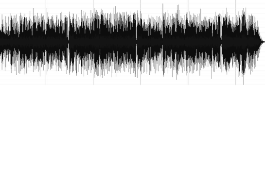

# music-rearranger
#### Rearrange a music recording so that it matches a new desired duration.



Code for "Music rearrangement using hierarchical segmentation" ICASSP 2023 paper (https://arxiv.org/abs/2305.07347).

### Disclaimer

This code is not 100% reflecting every detail described in the paper, but the path finding stage now follows the sparse graph-search formulation described there. It searches over the identified transition points with a Dijkstra-style optimization instead of limiting the rearrangement to a small fixed number of cuts.

I'm aiming to develop this package further, including doing some work on finding more optimal default parameters for the segmentation and transition point identification configuration. Submiting issues and pull request is welcomed and appreciated.

### Installation

Install non-python dependencies:

* ffmpeg
* sox (with support for mp3)
* libsndfile

On Debian/Ubuntu you can install them with the following:

```bash
apt-get update --fix-missing && apt-get install libsndfile1 ffmpeg libsox-fmt-all sox -y
```

Then, create a python environment with python=3.7 and install the dependencies in `requirements.txt`. For example, using a conda environment:
```bash
conda create -n rearranger python=3.7
conda activate rearranger
pip install -r requirement.txt
```

For Apple Silicon/macOS, use the uv-based setup in `requirements-macos-uv.txt` instead. It pins a modern Python 3.11 stack that runs the fast segmentation pipeline locally:

```bash
brew install portaudio
uv venv .venv --python 3.11
uv pip install --python .venv/bin/python -r requirements-macos-uv.txt
uv pip install --python .venv/bin/python madmom==0.16.1 --no-build-isolation
```

### Running

There are two key aspects to this rerrangement method: 1. segmentation and 2. path finding using the identified transitions points. You can compute the segmentation information once, and use it to rearrange the piece multiple times. So the first command you can run is:

```bash
python rearrange.py --input_audio /path/to/audio/file --target_time 60
```

where the value of `--target_time` is the desired duration of the rearrangement in seconds.

After having computed the rearrangement, a pickle file and an audio file will be created. You can use the pickle file as an argument so that you don't recompute the structure every time.

```bash
python rearrange.py --input_audio /path/to/audio/file --input_seg /path/to/segmentation/pickle/file --target_time 60
```

Other useful options include:

`--seg_method`: segmentation method to use. This currently includes the Salamon et al. 2021 segmentation method (`precise`) which is more accurate but slower, as well as the McFee & Ellis 2014 segmentation method (`fast`) which is less accurate but faster.

`--use_gpu` (flag): whether to use the GPU for the feature computation for the `precise` segmentation.

`--output_dir`: output directory for audio and pickle file.

`--config`: path to configuration file with various segmentation, transition identification, and path finding parameters.

`--plot` (flag): whether to save plots of the features and segmentation that is computed.

To run the real segmentation benchmark on 10 open MP3s and generate cutpoint/path diagnostics:

```bash
.venv/bin/python scripts/real_segmentation_benchmark.py --limit 10 --plot-segmentation
```

### Reference

```
@inproceedings{music-rearranger,
    Author = {C. Plachouras and M. Miron},
    Booktitle = {ICASSP 2023-2023 IEEE International Conference on Acoustics, Speech and Signal Processing (ICASSP)},
    Month = {Jun.},
    Title = {Music rearrangement using hierarchical segmentation},
    Year = {2023}}
```
